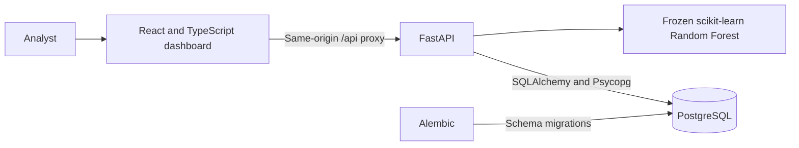
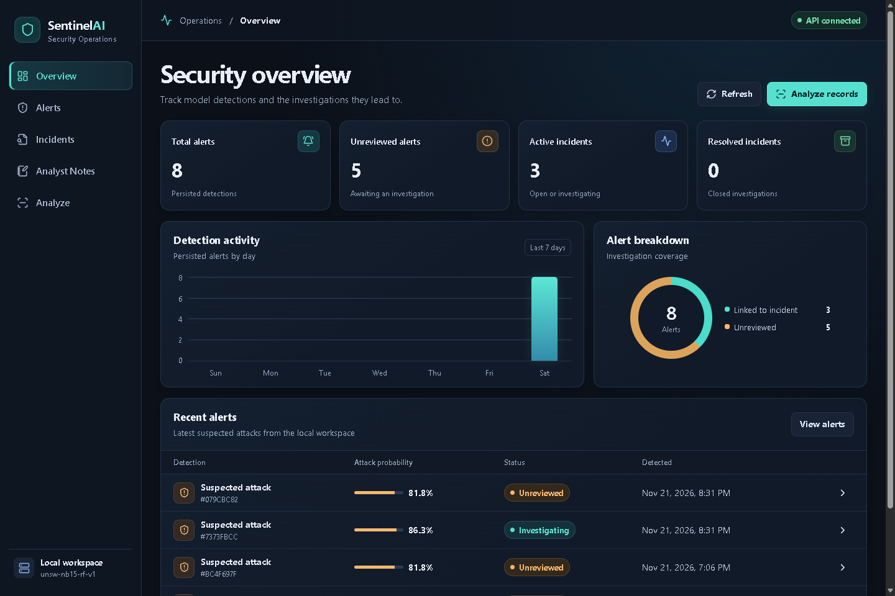
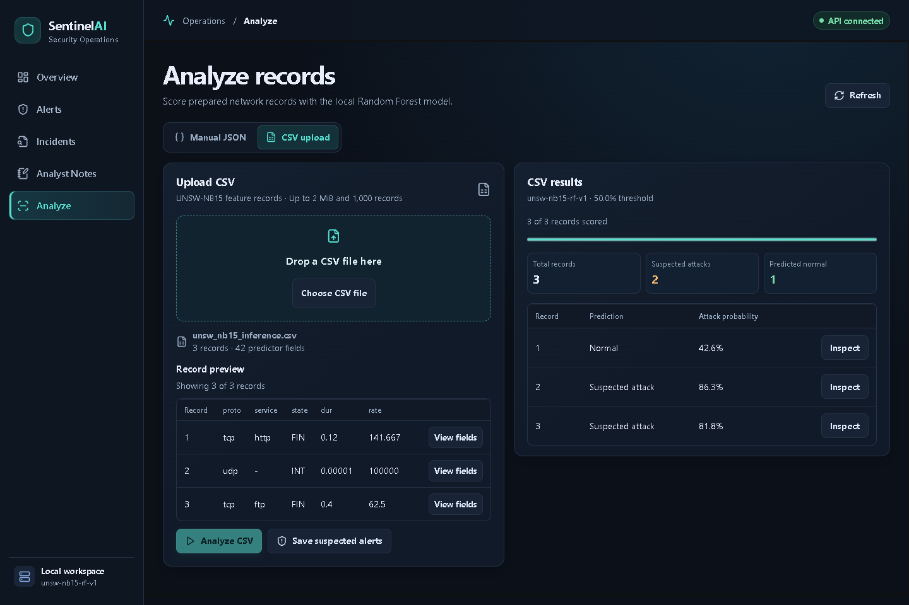

# SentinelAI

SentinelAI is a local graduation-project prototype for network intrusion
detection and incident management. It scores prepared UNSW-NB15
network-flow records with a binary classifier and lets an analyst turn
suspected attacks into investigations with notes. [UNSW-NB15 dataset](https://research.unsw.edu.au/projects/unsw-nb15-dataset)

[Documentation](docs/README.md) · [Lab guide](docs/LAB_GUIDE.md) ·
[Research archive](docs/research/README.md) · [Roadmap](docs/ROADMAP.md)

## What Level 1 delivers

- A React dashboard with detection statistics, alert filtering and
  details, incident status, and analyst notes.
- CSV upload and manual JSON entry with validation, scoring, and optional
  alert persistence. CSV previews show the input before scoring, and users
  can inspect individual predictions and attack probabilities.
- A frozen 48-tree Random Forest with its fitted preprocessing, an ordered
  42-feature schema, and a default threshold of 0.5.
- Local PostgreSQL storage for prediction batches, alerts, incidents, and
  notes. Transactional writes and idempotent batch retries prevent duplicate
  alerts when the same submission is retried.

## Level 2 research status

The controlled lab verifies isolation, records authorized traffic, and extracts
Zeek-native flow features with pinned capture and labeling evidence. G27 verified
four benign sessions, 266 packets, and 16 labeled flows across one VM pair.
The lab is experimental and runs separately from the dashboard. Independent
device and environment validation is still needed before fitting a Level 2
model. [G27 results](docs/research/lab/LEVEL_2_G27_BENIGN_COLLECTION.md)

## Architecture and technologies



| Layer | Technology |
|---|---|
| Dashboard and tools | React, TypeScript, Vite, Vitest |
| API and validation | Python 3.12.3, FastAPI, Pydantic, Uvicorn |
| Model | scikit-learn pipeline with a Random Forest classifier |
| Storage and migrations | PostgreSQL, SQLAlchemy, Psycopg, Alembic |
| Integration tests | Python unittest, HTTPX, isolated PostgreSQL test schemas |

CSV validation, scoring, and persistence are separate API operations.
`/csv/preview` validates the file. `/predict` returns scores without
database writes. `/analyze` scores and persists the batch and any suspected
attacks. Vite forwards browser requests to the loopback FastAPI server.
[Architecture and request flows](docs/ARCHITECTURE.md)

## Screenshots

The dashboard screenshots use synthetic demonstration records. The overview
counts describe the local database, and the scored CSV example has three
records. See the benchmark results below for model evaluation.





## Local installation

The following instructions use Windows PowerShell. Install Python **3.12.3**
for the original artifact runtime, Node.js **22.12 or newer**, and a local
PostgreSQL server. PostgreSQL 18.7 was used for the project. Configure the
database server to listen on loopback. [Database setup](docs/DATABASE_SETUP.md)

### 1. Install dependencies

```powershell
git clone https://github.com/HandlessCoding/SentinelAI.git
Set-Location SentinelAI
py -3.12 --version
py -3.12 -m venv .venv
& .\.venv\Scripts\python.exe -B -m pip install --only-binary=:all: pip==26.3
& .\.venv\Scripts\python.exe -B -m pip install --only-binary=:all: -r ml/requirements-baseline.txt -r backend/requirements.txt
```

### 2. Create local databases

In your own PostgreSQL administrator `psql` session, create a role and two
databases. The password command prompts you to choose a password locally.

```sql
CREATE ROLE sentinelai_user LOGIN;
\password sentinelai_user
CREATE DATABASE sentinelai_dev OWNER sentinelai_user;
CREATE DATABASE sentinelai_test OWNER sentinelai_user;
```

Set `SENTINELAI_DB_PASSWORD` to that password in an ignored root `.env` file
or in the local process environment. If you use different database names
or connection settings, use the variables in the
[database setup guide](docs/DATABASE_SETUP.md). All setup works with your
own local credentials.

### 3. Provide a trusted model package

Place `pipeline.pkl` and `metadata.json` under
`artifacts/unsw-nb15-rf-v1/`. With this package, the application and demo
run without dataset CSVs.

For an independent local build, obtain the official **training** CSV from
UNSW and follow the [model packaging guide](docs/MODEL_PACKAGING.md) in a
fresh checkout. The [G10 evaluation](docs/FINAL_MODEL_EVALUATION.md) pins
the original artifact and recorded training-file checksum. A rebuilt local
package should be treated as a separate build unless those fingerprints
match. The official test CSV is reserved for reproducing G10 evaluation.

### 4. Migrate and start both services

From the repository root in the first terminal:

```powershell
& .\.venv\Scripts\python.exe -B -m alembic upgrade head
& .\.venv\Scripts\python.exe -B -m uvicorn backend.main:app --host 127.0.0.1 --port 8001
```

In a second terminal, from the repository root:

```powershell
Set-Location frontend
npm.cmd ci
npm.cmd run dev
```

Open the [dashboard](http://127.0.0.1:5173) or [API docs](http://127.0.0.1:8001/docs).
Use Ctrl+C in each terminal to stop that service.

## Try the analyst workflow

1. Open **Analyze → CSV upload**. Choose [the bundled synthetic CSV](examples/unsw_nb15_inference.csv).
2. Review the preview and select **Analyze CSV**. Inspect a prediction to
   see its features and attack probability.
3. Select **Save suspected alerts** and open an alert from the receipt.
   Retrying with the same records returns the existing alert IDs.
4. Create an investigation, set its status to **Investigating**, and
   add an analyst note. If the alert is already linked, open its existing
   investigation.

CSV uploads require a header and use UTF-8 encoding, with limits of
1,000 data records and 2 MiB. All 42 predictors are required. Optional `id`, `label`, and `attack_cat`
columns are ignored for inference. The API scores batches of up to 100
records. The bundled example contains synthetic rows. [Dashboard usage](docs/DASHBOARD_SETUP.md)

## Evaluation and limitations

G4 reports pooled, group-aware validation within the training partition.
G10 evaluates the frozen pipeline on the **82,332 records** in the official
test partition. Both columns use threshold 0.5.

| Metric | G4 training validation | G10 official test |
|---|---:|---:|
| Balanced accuracy | 92.39% | 83.27% |
| Precision | 93.74% | 78.77% |
| Attack recall | 98.84% | **99.35%** |
| False-positive rate | 14.06% | **32.81%** |
| ROC AUC | 0.9912 | 0.9824 |

The test run flagged **12,140 of 37,000 normal records**. Also, 8,541 test
rows (10.37%) had an exact predictor match in training. The false-positive
rate on rows without an exact match was still 32.735%. These results characterize
the prepared cyber-range benchmark. Live-network detection, feature mapping,
and operational alert volume remain unvalidated. The application assumes a
trusted local machine, and a process with loopback access can use its
unauthenticated API. [Full evaluation](docs/FINAL_MODEL_EVALUATION.md)

## Tests and production build

From the repository root with the saved artifact and local test database
configured:

```powershell
& .\.venv\Scripts\python.exe -B -m alembic current
& .\.venv\Scripts\python.exe -B -m alembic check
& .\.venv\Scripts\python.exe -B -m unittest discover -s tests -v
Set-Location frontend
npm.cmd test
npm.cmd run build
```

PostgreSQL integration tests migrate fresh schemas inside the dedicated test
database. Synthetic fixtures do not require dataset CSVs. The real-Zeek test
requires the Linux sensor, and local recorded-capture tests use opt-in
paths. Datasets, local credentials, fitted models, captures, and VM images
are Git-ignored. [Test scope](docs/RELIABILITY_TESTING.md) ·
[Latest engineering verification](docs/G27_5_ENGINEERING_REVIEW.md#verification)

## Project materials

| Document | Purpose |
|---|---|
| [Project explanation](PROJECT_EXPLANATION.md) | Beginner-friendly walkthrough for the project defense |
| [Technical report](docs/TECHNICAL_REPORT.md) | Research, methods, implementation, results, and limitations |
| [Architecture](docs/ARCHITECTURE.md) | Component diagrams and analyst workflow |
| [Presentation and demo](docs/PRESENTATION_AND_DEMO.md) | Suggested talk, live walkthrough, and fallback |
| [Project status and roadmap](docs/ROADMAP.md) | Implemented capabilities, proposed G28 work, and planned Level 2 features |
