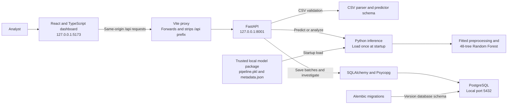
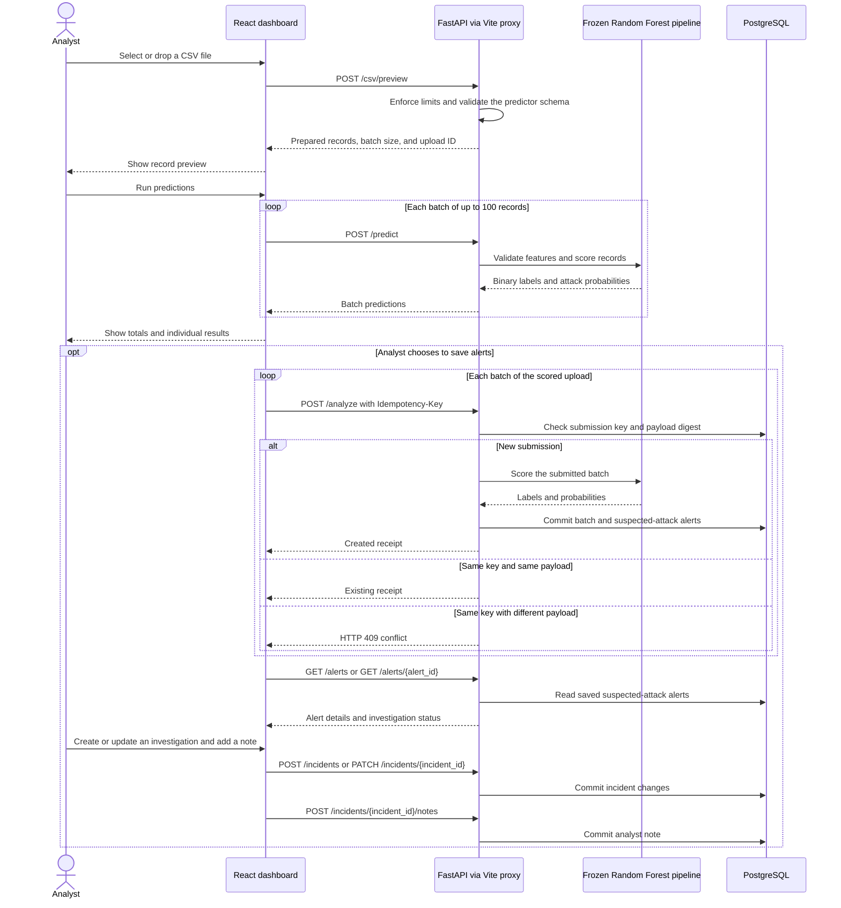

# SentinelAI Level 1 architecture

SentinelAI is a local application for scoring prepared UNSW-NB15 feature records and tracking suspected attacks. The React dashboard handles file selection, preview, and analyst actions. FastAPI validates inputs and calls a frozen Random Forest package. PostgreSQL stores prediction batch metadata, suspected-attack alerts, incidents, and notes.

## Components and local boundaries

- The dashboard uses same-origin `/api/` requests. Vite forwards them to FastAPI on loopback in both its development server and its local build preview. FastAPI validates the request host. PostgreSQL credentials belong to the backend's local environment. [Vite configuration](../frontend/vite.config.ts), [API startup](../backend/main.py), [Database configuration](../backend/database.py)
- The API loads the trusted `unsw-nb15-rf-v1` package at startup. It checks metadata, dependency versions, and the pipeline checksum before loading the serialized model. The package includes the fitted transformations and the classifier. API traffic uses the existing fit. [Inference module](../ml/inference.py), [Model packaging](MODEL_PACKAGING.md)
- Training and benchmark evaluation run as separate Python commands. Training reads the official training CSV to build the local artifact. The final evaluator reads the frozen artifact and the official test partition to measure performance. The application runtime consumes validated predictor records and the artifact. Datasets, local database settings, and model binaries stay outside Git. [Training code](../ml/train_model.py), [Final evaluation](FINAL_MODEL_EVALUATION.md), [Git exclusions](../.gitignore)

## CSV analysis and investigation

`POST /csv/preview` validates an uncompressed UTF-8 CSV of up to 2 MiB and 1,000 data rows. It prepares all 42 required predictors in schema order and drops the optional `id`, `label`, and `attack_cat` columns. The preview parses inputs without scoring. `POST /predict` scores batches of up to 100 records and returns one prediction per record, with no database writes. The manual JSON workflow uses the same prediction routes. [CSV route](../backend/csv_uploads.py), [Prediction route](../backend/routes.py), [Dashboard workflow](DASHBOARD_SETUP.md)

Saving calls `POST /analyze` with the prepared records. The API obtains its own inference results and writes the batch and its alerts in one transaction. It stores one suspected-attack alert per positive prediction. For the frozen model, a score strictly greater than `0.5` produces an attack prediction. PostgreSQL enforces key uniqueness, including when two requests arrive concurrently. The CSV client shares a byte-aware batch plan between scoring and saving. Each save commits independently, so a retry can recover receipts and continue with the remaining batches. [CSV batch plan](../frontend/src/csvBatches.ts) · [Investigation routes](../backend/investigations.py) · [Retry behavior](DASHBOARD_SETUP.md#upload-and-analyze-csv)

## Stored records

| Entity | Purpose and relationships |
|---|---|
| `prediction_batches` | One row for each accepted save batch. It records the submission key, input digest, record count, model version, threshold, and prediction timestamp. A batch can have zero or more alerts. |
| `alerts` | A suspected-attack record with an attack probability and its zero-based position in the batch. It belongs to one batch and can be attached to one incident. |
| `incidents` | Analyst investigation with a title, description, status, and timestamps. It collects one or more alerts when created. |
| `analyst_notes` | Author text, note text, and creation time for one incident. Incident details include its notes. |

The database schema stores the metadata above and the analyst's investigation content. The dashboard's uploaded CSV and prepared feature vectors are transient inputs. An unattached alert is `unreviewed`. An attached alert reflects its incident's `open`, `investigating`, or `resolved` status. [SQLAlchemy models](../backend/models.py), [Initial migration](../migrations/versions/0001_alert_investigations.py), [Database setup](DATABASE_SETUP.md)

## Offline Zeek traffic

The local importer verifies one capture and its Zeek log through the lab
registry, then commits `zeek_captures` and `zeek_flows` in one transaction.
Read-only `/traffic` routes feed the dashboard's Network Traffic page. The
flow record stores reviewed ground truth and an optional versioned rule code.
Level 1 predictions and analyst investigations retain their separate storage.
[Capture import and read API](DATABASE_SETUP.md#import-reviewed-zeek-flows-offline)

### Continuous Zeek ingestion

The G36 worker reads a local Zeek log, committing flows, its checkpoint,
and source health in one PostgreSQL transaction. Network Traffic shows
recorded replay and connected sensor inputs with stable cursor browsing.
Reviewed ground truth, rule findings, and alerts remain distinct. G36
verified continuous ingestion with recorded replay. G37 defines the future
isolated live pilot. [Worker and browsing](DATABASE_SETUP.md#run-continuous-zeek-ingestion) · [G36 evidence](LAB_GUIDE.md#g36-continuous-replay-verification) · [G37 decision](adr/0002-g37-sensor-local-postgresql.md)

## Runtime behavior

The API validates JSON media type, encoding, request size, record count, and predictor values. Server-side limits also apply to direct API clients. A database outage makes alert and investigation operations return a generic `503`. CSV preview, prediction, and API health remain available with the model loaded. `/health` reports API availability. If the model package is missing or fails validation, API startup fails. [API startup and errors](../backend/main.py), [JSON request limits](../backend/request_limits.py), [Reliability testing](RELIABILITY_TESTING.md)

The supported deployment is a local demonstration for trusted users. The system accepts prepared benchmark-format predictors, produces reviewable suspicions, and organizes human investigation. Live traffic feature extraction, live-network detection effectiveness, and operational alert volume require separate validation. [Final evaluation limitations](FINAL_MODEL_EVALUATION.md#limits-and-interpretation)
