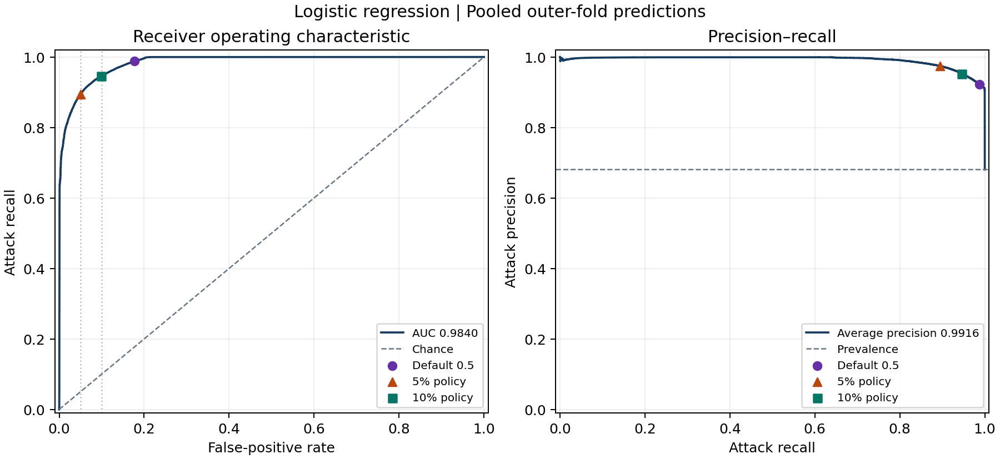

# G3 decision-threshold analysis

## Reproduction

Run from the repository root in PowerShell with the G2 requirements installed
in the Python 3.12.3 virtual environment. The experiment reads
`data/UNSW_NB15_training-set.csv`. Install Matplotlib for the optional figure,
then run the suite and the experiment.

```powershell
& .\.venv\Scripts\python.exe -B -m pip install --only-binary=:all: matplotlib==3.10.7
& .\.venv\Scripts\python.exe -B -m unittest discover -s tests -v
& .\.venv\Scripts\python.exe -B -m ml.run_threshold_analysis --plot docs/THRESHOLD_CURVES.png
```

The runner prints fit progress and returns the fold audit, thresholds, metrics,
library versions, and training-file SHA-256 as JSON. Omit `--plot` for a
metrics-only run. The original [G2 experiment and results](BASELINE_RESULTS.md)
remain the reference for default-threshold performance.

## Method

1. Reuse the G2 logistic regression and preprocessing. The 42 raw predictor
   values define the group key after excluding `id`, `label`, and
   `attack_cat`. Keep the original labels and all duplicates, including the
   229 groups with conflicting binary labels.
2. Reproduce G2's three outer `StratifiedGroupKFold` splits with seed 42.
   Within each outer training subset, make three inner group-aware splits
   with seed 43. Fit fresh preprocessing and logistic regression on each
   inner training subset. Pool inner validation scores so each outer training
   row contributes one prediction from a fit that excluded its group.
3. For each budget, check all distinct inner scores as candidate thresholds,
   predicting attack at or above the threshold. Maximize attack recall
   subject to the budget. Break ties by lower false-positive rate (FPR),
   then by higher threshold. Evaluate equal scores together. If only the
   all-normal policy would meet the budget, report that no finite threshold
   predicting any attack is available for that fold.
   [scikit-learn ROC threshold convention](https://scikit-learn.org/1.7/modules/generated/sklearn.metrics.roc_curve.html)
4. Once both thresholds are fixed, fit the same pipeline on the complete
   outer training subset and score the outer validation subset. Apply the
   two selected thresholds and G2's default rule of attack score strictly
   greater than 0.5. Compute metrics with attack as positive, then pool
   outer decisions so each record contributes once.

The official testing partition remains reserved for final evaluation. Every
split verifies zero shared raw predictor groups before fitting.

## Split verification

The run used all **175,341** training rows
(56,000 normal and 119,341 attack) across
101,040 distinct raw predictor groups. Default-threshold
confusion matrices matched G2 exactly on all three outer folds.

| Outer fold | Training groups | Validation groups | Shared outer groups | Shared groups in inner folds 1 / 2 / 3 |
|---:|---:|---:|---:|---:|
| 1 | 67,381 | 33,659 | 0 | 0 / 0 / 0 |
| 2 | 67,335 | 33,705 | 0 | 0 / 0 / 0 |
| 3 | 67,364 | 33,676 | 0 | 0 / 0 / 0 |

The training file SHA-256 matched G2
(`bec7dd5ec88dc2a0ccc7a07879d338395ed7421750f675fd0339e07dfe0648fa`). Runtime
versions were Python 3.12.3, scikit-learn 1.7.2,
NumPy 2.2.6, SciPy 1.15.3, joblib 1.5.2,
threadpoolctl 3.6.0, and Matplotlib 3.10.7.
All 21 automated tests passed. The 12 fits emitted no model warnings, and
`pip check` reported consistent dependencies.

## Thresholds and budget checks

All six budget and fold combinations had eligible inner thresholds. Thresholds
are rounded here. Classification and budget checks used full precision.

| Outer fold | Policy | Selected threshold | Inner recall | Inner FPR | Outer FPR | Outer budget met |
|---:|---|---:|---:|---:|---:|:---:|
| 1 | 5% budget | 0.78034844 | 89.197% | 4.992% | 4.769% | Yes |
| 1 | 10% budget | 0.69497756 | 94.680% | 9.995% | 10.144% | No |
| 2 | 5% budget | 0.77700610 | 89.365% | 4.998% | 5.206% | No |
| 2 | 10% budget | 0.69581266 | 94.447% | 9.999% | 9.795% | Yes |
| 3 | 5% budget | 0.77371422 | 89.401% | 4.999% | 5.088% | No |
| 3 | 10% budget | 0.69257281 | 94.589% | 9.987% | 9.858% | Yes |

## Outer evaluation metrics

Confusion matrix counts use actual rows and predicted columns ordered normal
then attack, giving TN, FP, FN, and TP.

| Fold | Policy | Recall | Precision | F1 | Balanced accuracy | FPR | TN | FP | FN | TP |
|---:|---|---:|---:|---:|---:|---:|---:|---:|---:|---:|
| 1 | Default 0.5 | 98.783% | 92.186% | 95.371% | 90.453% | 17.877% | 15,325 | 3,336 | 485 | 39,359 |
| 1 | 5% budget | 89.321% | 97.560% | 93.259% | 92.276% | 4.769% | 17,771 | 890 | 4,255 | 35,589 |
| 1 | 10% budget | 94.556% | 95.216% | 94.885% | 92.206% | 10.144% | 16,768 | 1,893 | 2,169 | 37,675 |
| 2 | Default 0.5 | 98.862% | 92.033% | 95.325% | 90.544% | 17.774% | 15,447 | 3,339 | 444 | 38,569 |
| 2 | 5% budget | 89.291% | 97.269% | 93.109% | 92.042% | 5.206% | 17,808 | 978 | 4,178 | 34,835 |
| 2 | 10% budget | 94.533% | 95.248% | 94.889% | 92.369% | 9.795% | 16,946 | 1,840 | 2,133 | 36,880 |
| 3 | Default 0.5 | 98.767% | 92.444% | 95.501% | 90.577% | 17.614% | 15,285 | 3,268 | 499 | 39,985 |
| 3 | 5% budget | 89.744% | 97.468% | 93.447% | 92.328% | 5.088% | 17,609 | 944 | 4,152 | 36,332 |
| 3 | 10% budget | 94.667% | 95.445% | 95.054% | 92.404% | 9.858% | 16,724 | 1,829 | 2,159 | 38,325 |

### Pooled outer decisions

The pooled metrics use all held-out decisions directly, so each row counts
once. G2's mean metrics instead give each fold equal weight.

| Policy | Recall | Precision | F1 | Balanced accuracy | FPR | TN | FP | FN | TP |
|---|---:|---:|---:|---:|---:|---:|---:|---:|---:|
| Default 0.5 | 98.803% | 92.223% | 95.400% | 90.524% | 17.755% | 46,057 | 9,943 | 1,428 | 117,913 |
| 5% budget | 89.455% | 97.434% | 93.274% | 92.217% | 5.021% | 53,188 | 2,812 | 12,585 | 106,756 |
| 10% budget | 94.586% | 95.304% | 94.944% | 92.327% | 9.932% | 50,438 | 5,562 | 6,461 | 112,880 |

The **5% policy** met its budget in **one of three** outer folds and missed it
in the pooled result by **12 false positives** (2,812 versus a 2,800 maximum).
Relative to the default, it produced 7,131 fewer false positives and 11,157
more missed attack records.

The **10% policy** met its budget in **two of three** outer folds. Its pooled
FPR met the budget, while fold 1 reached **10.144%**. Relative to the default,
it produced 4,381 fewer false positives and 5,033 more missed attack records.

## ROC and precision–recall curves



The pooled outer scores achieved **0.9840 ROC AUC** and
**0.9916 average precision**. The lines describe pooled
score rankings across outer fits. Markers show held-out decisions under the
three policies. The two tuned policies used different thresholds per outer
fold and can therefore sit off the pooled lines. The curves were generated
after evaluation for description.

## Interpretation and limits

Higher thresholds reduced false alerts and improved precision at the cost of
missed attacks. Optimizing at the edge of a budget on inner scores provided
limited margin when scores came from a refit on the larger outer training
subset. Budget misses on held-out folds show that the observed inner rates
are insufficient to guarantee future compliance.

These are row-weighted estimates from a single nested split of the prepared
training partition. Repeated records still influence the results. Exact raw
grouping controls identical predictor vectors, while near-duplicates and
relationships among flows can still affect estimates. Holdout performance and
operational alert volume remain unmeasured.
