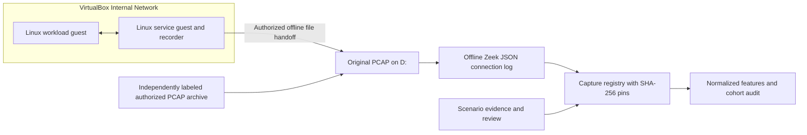

# G25 Controlled Network Lab and Capture Foundation

The offline capture registry, Zeek processing command, feature extractor, and
cohort audit are implemented. The synthetic demonstration passed. The isolated
VMs, real Zeek decoding, and meaningful unseen-capture evaluation still need
verification. No collector, virtual switches, guest networks, or packages were
installed or changed in G25.

## Why collect new data

NF-ToN-IoT-v2 lacks a reliable mapping to its source recordings. Corrected
CIC-IDS2017 made chronological comparisons possible to audit, but its development
splits retain same-campaign dependencies. IoT-23 had limited independently
reviewable benign traffic, incomplete device lineage, and many different labels
on otherwise identical vectors. G25 preserves scenario evidence and recording
boundaries at collection time. It keeps provenance checks distinct from model
metrics and leaves Level 1 and the reserved NF-CSE-CIC-IDS2018 benchmark outside
the lab workflow. [G13 data strategy](../level-2/LEVEL_2_DATA_STRATEGY.md) ·
[G17 provenance](../level-2/LEVEL_2_PROVENANCE_AND_DATA.md) ·
[G19 chronological preflight](../level-2/LEVEL_2_CHRONOLOGICAL_BASELINE.md) ·
[G20 capture validation design](../level-2/LEVEL_2_CAPTURE_DATA_STRATEGY.md) ·
[G24 reconciliation](../level-2/LEVEL_2_IOT23_CAPTURE_RECONCILIATION.md)

## Host assessment and proposed architecture

| Area | Read-only finding | Setup decision |
| --- | --- | --- |
| Windows | Registry reports Windows Home (Core), build 26300. The CPU is an AMD Ryzen 5 5600H, with 12 logical processors and 31.4 GiB RAM available to the OS in total. The firmware virtualization query returned enabled. The SLAT query was negative and WMI access was denied, so guest operation remains unverified. | Boot a small guest as the first approved infrastructure check. |
| Virtualization | Oracle VirtualBox 7.2.8 is installed and returned its version. Its support service was stopped at inspection. Hyper-V Manager was absent. | Start with the existing VirtualBox installation. |
| WSL2 and containers | The WSL launcher reports WSL is absent. Docker, Podman, and VMware commands were unavailable. | Use Linux guests for capture and Zeek. Reserved offline analysis can also use a Linux machine with the same tools. |
| Collection tools | Zeek, TShark, and the Rust compiler were unavailable on the host PATH. | Add a pinned Zeek package and a guest capture utility after approval. Rust can follow once capture parity is measured. |
| Storage | D: had approximately 164 GiB free. C: had approximately 150 GiB free. | Put VM disks and all capture artifacts under `D:\Coding\Projects\SentinelAI\data\level2\capture-lab\`. |

On Windows Home, use two small Linux guests connected to the same named
VirtualBox **Internal Network**. One runs ordinary client workloads. The other
runs local services and records the client–service boundary from its guest
interface. Two vCPUs and 2 GiB RAM per guest are a starting budget for short
smoke recordings. A dedicated sensor is a future option if the two-guest
observation point proves insufficient. The virtual adapter is Internal Network
only during recording. Review the powered-off settings for extra adapters,
shared folders, clipboard integration, and forwarding before collecting. Use a
separate disconnected Linux analysis guest for imported, authorized archives if
needed. Archives are read as files. [VirtualBox Internal Networking](https://docs.oracle.com/en/virtualization/virtualbox/7.2/user/networkingdetails.html) ·
[Microsoft Hyper-V requirements](https://learn.microsoft.com/en-us/windows-server/virtualization/hyper-v/host-hardware-requirements) ·
[Microsoft WSL networking](https://learn.microsoft.com/en-us/windows/wsl/networking)



After approval, pin the Linux image, capture tool, Zeek release, and device
images in a local collection profile. Set the same observation point, clock
method, link type, capture settings, and Zeek policy for matched recordings.
Verify guest operation and isolation using only benign lab traffic. Then check
that the sensor sees both directions with correct packet accounting. Stage guest
software before data collection, with the approved recording topology in place
before any research session begins. An isolated benign smoke recording is the
first operational checkpoint. [Official Zeek installation options](https://docs.zeek.org/en/current/install.html)

## Collection and labeling protocol

1. **Assign the recording identity first.** Create a capture ID for each original
   recording and a session ID for its original run. Filters, re-exports, and
   fragments of that run keep its session identifier and its assigned role.
   Device IDs refer to actual device or guest lineage, including related
   snapshots and clones. Environment and observation-point IDs describe where
   packets were visible. Keep labels out of these IDs and predictors.
2. **Collect matched benign traffic.** Use ordinary local transactions such as
   fetching a file, reading a local page, and routine DNS queries against a
   lab DNS service. Keep run notes and server-side event evidence independent
   of Zeek. Collect benign and authorized attack recordings under comparable
   collection conditions. Start with previously recorded, independently
   annotated positive traffic for which the lab has explicit research-use
   permission. Review any provenance or collection differences before pooling.
3. **Review what the sensor actually observed.** Store the evidence author,
   distinct reviewer, authorized scenario, UTC event bounds, observation-point
   scope, and limitations in a local evidence record. An attack label requires
   documented scenario or independent annotation evidence. A benign label
   requires affirmative evidence for ordinary activity. Time windows suffice
   only when the reviewer can attest that every observed flow within the window
   has the stated label. Leave intervals with mixed or ambiguous activity
   outside the reviewed windows. Endpoints, ports, feature rules, and detector
   outputs are excluded from label assignment.
4. **Preserve files and clock bounds.** Record the source, permission reference,
   original UTC recording bounds, device identities, collection profile,
   clock offset and packet loss observations where known. Preserve the raw
   original after capture. Reprocess it to a distinct Zeek run directory.
   Store checksums with the capture manifest and retain the manifest outputs
   locally. A checksum establishes byte integrity. Evidence and permission are
   still reviewed by people with access to the source.
5. **Assign flow labels conservatively.** The parser uses the connection's UTC
   start and observed duration. A flow must start and finish within one reviewed,
   half-open interval to inherit that label. Unreviewed intervals, unclear
   timestamps, missing durations, and boundary-spanning flows remain
   `unknown`. Preserve those rows and report the reasons. This restriction can
   disproportionately affect one-packet or incomplete flows. Measure it before
   using any cohort for training or evaluating a low false-positive rate.

## Local workflow

The Python tools use the standard library. Paths in manifests use forward
slashes and resolve under the lab root. Keep captures, evidence, manifests, and
all generated outputs inside the ignored `data/` tree.

1. In a Linux analysis environment, run the trusted Zeek binary against a local
   PCAP using the same tracked Python module and the local lab-root path.
   The command passes `-r` and the pinned JSON and connection-size settings.
   Zeek's checksum verification stays enabled. It emits `conn.log` and a
   `run.json` receipt with the version, settings, and PCAP/log SHA-256 values.
   The command publishes these in a new run directory after successful decoding.

   ```bash
   python3 -B -m ml.lab_capture --root /path/to/lab zeek raw/run-01.pcap run-01
   ```

2. Create a version-1 draft JSON and save it under the lab root. The minimal
   authorized example below uses a benign-only evidence window. A reviewed
   `attack` window supplies a research category. A gap in `windows` represents
   `unknown`. Synthetic manifests use `source: "synthetic"` and can use a
   hand-authored connection-log fixture. The demo creates one such manifest.

   ```json
   {
     "version": 1,
     "capture_id": "run-01",
     "session_id": "session-01",
     "environment_id": "private-lab",
     "device_ids": ["client-a", "service-a"],
     "observation_point": "service-guest",
     "collection_profile": "lab-profile-v1",
     "scenario": "local-file-transfer",
     "source": "authorized_lab",
     "role": "fit",
     "start": "2026-11-22T12:00:00Z",
     "end": "2026-11-22T12:05:00Z",
     "pcap": "raw/run-01.pcap",
     "conn_log": "zeek/run-01/conn.log",
     "zeek_receipt": "zeek/run-01/run.json",
     "authorization": "evidence/permission-01.txt",
     "windows": [{
       "start": "2026-11-22T12:01:00Z",
       "end": "2026-11-22T12:03:00Z",
       "label": "benign",
       "evidence": "evidence/events-01.json",
       "evidence_kind": "scenario_event_log",
       "author": "operator-a",
       "reviewer": "reviewer-b",
       "scope": "all_observed_flows"
     }]
   }
   ```

3. From the Windows repository root, register the draft, extract normalized
   records, and audit the cohort. Substitute the IDs for the assigned captures
   when the full cohort is available. A valid audit can report failed gates.
   Read `passes_automated_gates` and `blockers` in the output. Retain outputs from
   successful commands and keep a dated copy of the cohort assignment and
   reviewed results before any later fitting.

   ```powershell
   & .\.venv\Scripts\python.exe -B -m ml.lab_capture register drafts/run-01.json
   & .\.venv\Scripts\python.exe -B -m ml.lab_capture records run-01
   & .\.venv\Scripts\python.exe -B -m ml.lab_capture audit run-01
   ```

The registry uses exclusive writes per capture ID, validates relative paths,
stores file SHA-256 values, and verifies them on extraction and audit.
The overlap audit streams connection records and uses bounded, disk-backed
exact-key counting. Each invocation accepts up to 256 original capture IDs.
Source PCAPs and logs remain unchanged. [Zeek offline command](https://docs.zeek.org/en/current/quickstart.html)

## Feature contract and diagnostics

| Fields | Meaning and treatment |
| --- | --- |
| `proto` | Zeek transport name. The core overlap candidate is TCP/UDP. Other transports remain in extraction and coverage reports. |
| `orig_pkts`, `resp_pkts` | Unsigned packet counts by Zeek originator and responder. |
| `orig_ip_bytes`, `resp_ip_bytes` | Directional IP-layer octets as counted by Zeek. These four packet and IP byte fields require the Zeek connection-size analyzer. |
| `duration_ns` | Zeek connection duration converted from seconds to integer nanoseconds. Zeek omits certain trailing TCP packets from duration, so window review needs guard intervals. |
| `orig_bytes`, `resp_bytes` | Directional payload bytes. These can be inferred from TCP sequence numbers. |
| `conn_state`, `service`, `history` | Zeek state symbol, identified application service string, and direction-aware event history. History letters can encode thresholded counts. |
| `missed_bytes` | Zeek's content-gap byte count, used as a collection quality diagnostic. |

Missing or invalid fields are emitted as `null` with a field-specific reason.
Measured zeros are retained. Connection state, history, service, and payload size
require a separate shortcut and parity review before any use as primary
predictors. Timestamps and endpoints are grouping diagnostics. Rust compatibility
requires recording the same packets, checking orientation and counters on paired
fixtures, and independently defining any connection-state or service mappings.
UNSW-NB15, CICFlowMeter, and Zeek retain separate feature contracts.
[Zeek connection record definitions](https://docs.zeek.org/en/current/scripts/base/protocols/conn/main.zeek.html#type-Conn::Info)

## Cohort design and readiness gates

Assign complete sessions and linked device groups before collection outcomes or
model scores are reviewed. Each role should have matched reviewed benign and
positive traffic. The plan allows similar VM configurations across roles while
requiring independent source runs. One lab supports an unseen-capture evaluation
within that setting. A different deployment environment requires its own
independently collected validation data.

| Role | Purpose and assignment |
| --- | --- |
| `fit` | Dedicated recording blocks for learning features and fitting preprocessing later. |
| `calibration` | Distinct blocks for probability or threshold work after fitting. |
| `comparison` | Distinct blocks for comparing configurations after calibration. |
| `validation` | At least two original positive sessions and adequate reviewed benign support from held blocks. Freeze access to these records for model selection, allowing prespecified aggregate preflight only. |

The automated audit flags duplicate PCAP/log hashes, cross-role device and
session reuse, overlapping clock windows at the same observation point, mixed
capture profiles or Zeek versions, and direction-independent five-tuples with
the same start time across roles. It reports feature-vector overlap, conflicts,
affected rows by role, and repeated tuples without deleting records. The
automated coverage gates require 1,000 eligible records per class and per role,
at least 50% retained coverage by class and by attack category with at least
100 labeled source rows, and two validation attack sessions. Independent human
review still resolves capture dependencies, reviews coverage of lost or unknown
flows, and checks whether the cohort can support meaningful FPR and recall.
[Prespecified G20 feasibility rules](../level-2/LEVEL_2_CAPTURE_DATA_STRATEGY.md#feasibility-gates-before-fitting)

In a later evaluation, report attack recall and false-positive rate per capture
with denominators, along with balanced accuracy, precision, and unknown or
unscored coverage. For stronger low-FPR claims, retain the G20 floor of 10,000
verified negatives and 1,000 verified positives from at least three defensibly
independent capture groups contributing each class. Repeated flows increase row
counts more quickly than they improve statistical certainty. The research
targets remain at least 95% accuracy, recall, and precision, and at most 5% FPR.

## Synthetic demonstration and next experiment

```powershell
& .\.venv\Scripts\python.exe -B -m ml.lab_demo --root data/level2/capture-lab/demo-new
& .\.venv\Scripts\python.exe -B -m ml.lab_capture --root data/level2/capture-lab/demo-new records fixture
```

Use a fresh demo directory each time. G25 generated a 480-byte PCAP with six
synthetic UDP frames offline and paired it with three hand-authored Zeek-format
records. It pinned the original and evidence, normalized three flows, produced
one benign label, one artificial attack label, and one unknown label, and
reported one shared typed vector with both known labels across three rows.
The fixture contributed zero rows to real cohort coverage. The Zeek subprocess
and receipt were tested with a stub. Once Zeek is available, pass
`--zeek-binary` to the demo to extract from its generated PCAP using the real
analyzer.

All 158 Python tests passed, including nine for the capture workflow. All 22
frontend tests passed and the production build succeeded. The Level 1 artifact
matched its pinned SHA-256.

For G26, approve the Linux guest and internal-network setup, verify Zeek against
the synthetic PCAP, then record a short ordinary client–service session. Compare
recorded packet directions, durations, and event times against the service
log and independently reviewed windows. A successful benign smoke run clears
the collection plumbing. Building a trainable cohort then depends on matched
authorized records with independent positive evidence and the frozen coverage
gates, including the two validation attack sessions.

The host-specific setup and verification record is available in
[G26 Isolated Linux lab and Zeek verification](LEVEL_2_G26_ZEEK_VERIFICATION.md).
